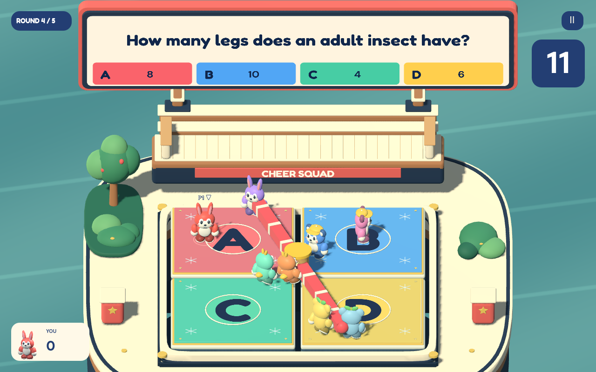
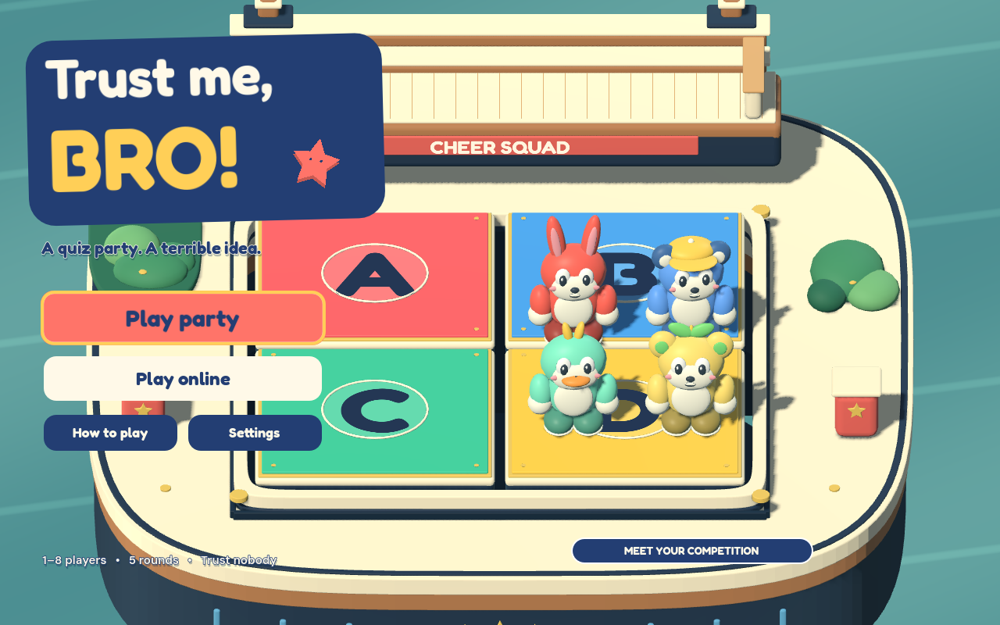

# TRUST ME, BRO!



An original quiz party with a cohesive Blender-authored game-show set, four expressive mascot types, five physical minigame twists, and **real host/join multiplayer**. Follow the friend who knows the answer, bluff, shove, and dive for safety before the wrong platforms fall. Every player shares the same fixed view of the board and spectator balcony.



## Play

On macOS, double-click **Play.command**. Or open `project.godot` in **Godot 4.5+** and press **F5**. This version was built and verified with Godot 4.8.dev3.

Choose **Play party** for couch play, or **Play online** for a network room. The next screen asks for your name and party details:

- **Couch party** — 1–4 humans on one screen, with bots filling the eight contestant slots. Pick the human count and press **Let's party!**
- **Host a room** — start a LAN / direct-IP party. Up to eight human players can join, one human per computer. Empty seats become bots when the host starts.
- **Join friends** — enter the host's IP address and port. Everyone presses **Ready**, then the host starts the party.

The room shows the host's local address. The default port is **UDP 24816**. For two instances on one computer, join `127.0.0.1`. For another computer on the same network, use the host's displayed private address. Over the internet, the host must be reachable at the chosen UDP port, for example through a configured router or an existing private gaming VPN. The game does not change router settings or provide a matchmaking relay. All players should use the same game version.

A running match accepts the players already in its lobby. A disconnected friend becomes a bot on the host; a disconnected client returns to the menu with a useful message. The host can replay after results. In an online match, opening help or the pause menu blocks your own input while the party continues for everyone.

## Controls

| Action | Keyboard 1 / network player | Keyboard 2 in couch play | Gamepad |
| --- | --- | --- | --- |
| Move | WASD | Arrow keys | Left stick |
| Jump | Space | Enter | A / bottom button |
| Shove / throw balcony junk | F | K | X / left button |
| Physical dive | G | L | B / right button |
| Point and bluff | H | ; | Right shoulder |
| Grab, steal, drop a cube | E | O | Y / top button |
| Nerd hint | Hold Tab | Hold Tab | Hold Select / Back |
| Pause / help close | Escape or P | Escape or P | Start |

**M** toggles sound. The **?** button explains the rules. All movement uses the same screen-aligned direction: W moves toward the top of the board. Gamepads are assigned from the last local human slot backward, supporting two keyboard players plus two pads for four-player couch play. Keyboard rollover limits depend on the hardware.

## Five rounds, one board

1. **Crowd Control** — correct answer pads shrink under a crowd. Shove your friends to make room.
2. **Lights Out** — memorize the labels during the first three seconds, then navigate with your mascot's flashlight.
3. **Grab a Brain** — the floor stays solid. One fewer physical cube than surviving contestants drops from above. Hold a cube bearing the correct answer letter. A lone survivor ends this round immediately.
4. **Slip & Panic** — icy pads and a rotating padded sweeper. Jump the beam or turn into a bowling ball.
5. **Final Answer** — five-second questions, inward conveyor forces, and progressively smaller platforms around the center gap.

Wrong answers and early falls eliminate a player for the current round. Eliminated friends return to the **Cheer Squad balcony**, where the shove button throws bananas and smoke bombs back at the stage. Everyone returns next round.

Surviving a question awards 100 / 125 / 150 / 175 / 200 points by round. Highest score after the finale wins. A complete match usually takes about three minutes.

## Lucky rolls

Between rounds, separate contestants receive Nerd Glasses, Heavy Boots, Pinball Curse, and a one-use last-second Swapper for a trailing player. Nerds can peek at the answer but advertise themselves with a siren. Heavy Boots double mass; Pinball Curse makes contact bouncy; the Swapper automatically trades positions with a random live opponent at one second remaining.

A Cursed Crown appears near the center of each question. Taking it doubles subsequent question awards for that round; falling or answering incorrectly with it wipes your entire score. Nerd hints are sent privately to their owner in network play. Couch players share one screen and must agree to look away during a secret peek.

## Question bank

`data/questions.json` contains **160 original questions** across Science, Nature, World, History, Arts, Sports, Games, and Brain Teasers. Each has an ID, category, difficulty, four distinct choices, correct index, and a concise explanation. The bank contains 56 easy, 56 medium, and 48 hard questions.

The deck shuffles answer positions and balances categories, without repeating a question until the full deck is exhausted. The giant screen shows the correct answer at the buzzer; the data retains explanations for authors and future teaching modes. `QuizBank.make_deck(rng, categories, difficulty)` also supports optional category/difficulty filtering for future course-specific sets. The host owns question order, timers and scoring; public network packets withhold correct answers before the buzzer.

## Art and viewpoint

The connected cream-and-timber showground, deep navy trap basin, integrated Cheer Squad balcony, marquee, beveled platforms, props, four mascot types, and portraits were made in Blender for this project. They use original meshes and materials. No AI-generated images/video or Nintendo assets are used. Sources and provenance are in `assets/world/ASSET_SOURCE.md`, `assets/characters/ASSET_SOURCE.md`, and `assets/props/ASSET_SOURCE.md`. Editable `.blend` files are included under `art/source` and `tools/source`; those folders are excluded from Godot importing and platform builds.

The question and four color-matched answers appear on a giant physical screen above the arena. The gameplay overlay has only a countdown, round number, local portrait/score and pause button. The full leaderboard appears after the match. Controls and sound live inside pause.

The fixed orthographic gameplay camera is identical on host, clients and couch screens, with the screen, balcony and answer pads visible together. The viewport preserves its aspect ratio. Remote bodies interpolate host snapshots; clients do not simulate competing physics or award their own points. Original music and cartoon cues are synthesized locally.

Mascots blink, lean into running, anticipate shoves, tuck into dives, squash on landing and celebrate scores. Short dust rings, impact bursts and score popups make contact and rewards readable without changing the authoritative physics. A quick **SAFE! / NOPE!** callout leaves falling players visible while the studio screen shows the correct answer. Rules get four seconds of reading time before the three-second countdown; Lucky Slop shows each perk and its recipient.

## Demo settings and export

Select **RoundManager** in `scenes/main.tscn` to tune countdowns, questions per round, shove force, ice friction, sweeper force, conveyor pull, pad shrinking and bot accuracy. Use the editor's **Remote** scene tree to change these in a running offline game or on the network host.

macOS, Windows and Linux export presets are included, with the JSON question bank explicitly included. Install matching Godot export templates through the editor before exporting; no standalone platform binaries are bundled here.

## Verification

From this project directory:

```sh
Godot --headless --path . --editor --import --quit
Godot --headless --path . --script res://tests/gameplay_test.gd
Godot --headless --path . --script res://tests/bot_match_test.gd
Godot --headless --path . --script res://tests/quiz_bank_test.gd
Godot --headless --path . --script res://tests/hud_test.gd
Godot --headless --path . --script res://tests/character_feedback_test.gd
Godot --headless --path . --script res://tests/quiz_screen_test.gd
python3 tests/run_network_test.py
```

The verification suites cover gameplay, full bot matches, question data, UI navigation, physical character feedback and four-process networking. Exact results and visual review records are in `docs/validation.json`.

The network runner launches independent ENet host and client processes. It tests actual movement input, all five rules, authoritative scoring, private hint handling, replay and disconnect replacement. Additional network edge-case checks cover rejection after a match starts and a missing host. The runner uses `GODOT_EXECUTABLE`, a `godot` executable on PATH, or the default macOS Godot location. Set `GODOT_EXECUTABLE` to your engine path if needed.

`tests/capture.gd` renders real menu/game/round/result views for visual review. `docs/tooling.md` records the installed Godot and Blender production tools. All fonts are bundled with their SIL Open Font Licenses.
